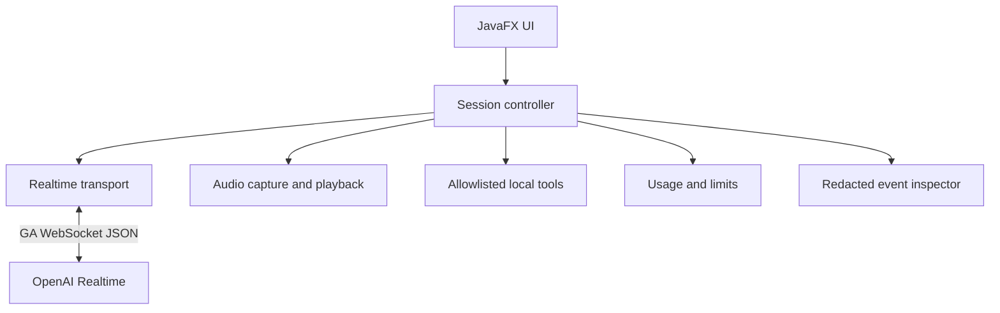

# Architecture

Single Gradle application, Java 27 and JavaFX CSS. Choose compatible pinned JavaFX/Gradle/Jackson/JUnit versions in RVL-001.

## Suggested packages
- ui: views, settings, FX presentation state
- realtime: socket transport, JSON codec, event routing, session controller
- audio: Java Sound devices and bounded PCM queues
- tools: small explicit registry and toy workspace
- usage: usage accounting, limits, metrics

Keep test seams small: transport interface, audio input/output abstraction and injectable clock. Do not introduce DI framework or speculative provider abstraction. Use JDK WebSocket demand control and handle fragmented text frames; bound message size, serialize outbound sends, apply timeouts. Offload blocking capture/playback to dedicated workers (virtual threads where appropriate); mutate UI only via JavaFX Application Thread. Batch deltas/inspector updates. Use bounded queues with explicit overflow failure instead of silent speech corruption.

## State
DISCONNECTED → CONNECTING → READY → CAPTURING / RESPONDING → READY → CLOSING → DISCONNECTED. Error is a recoverable terminal transition with cleanup; use independent playback/response state for audio still queued after response.done. Once closing begins, no new generation. Session generation IDs prevent stale callbacks changing a new session.

## Data
In-memory session context only, no durable database. Model configuration, active turn, tool-call IDs, aggregate usage and bounded redacted event history. No default transcript or audio exports. Credentials from local environment. Model/network failures must not lead to automatic retry loops.
